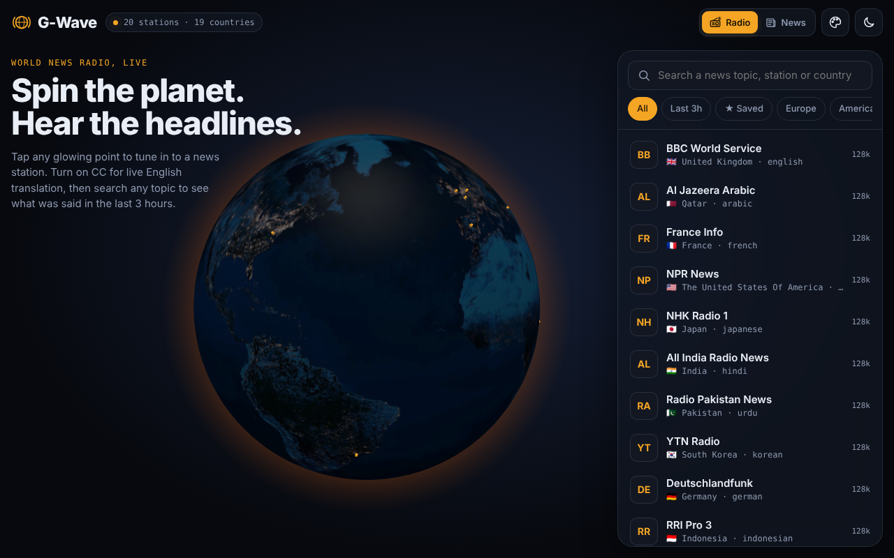
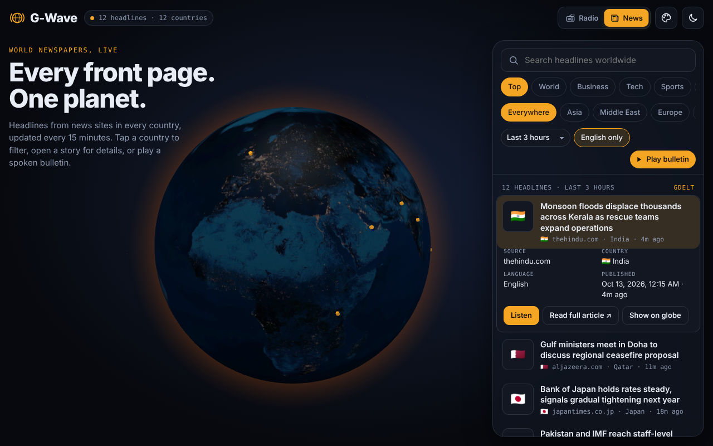
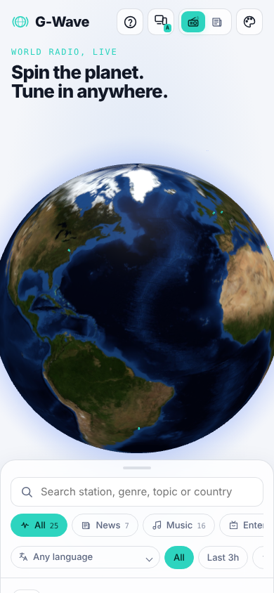

# G-Wave

**World news on a rotating 3D globe.** Tune in to live news radio from every continent with live English translation, or switch to News for newspaper headlines from around the world, read aloud.

Installable as an app (PWA), works on phones and desktops, no accounts, no API keys, no server.

| Radio | News | Phone |
|---|---|---|
|  |  |  |

> Screenshots use sample data.

## Features

**Radio**
- Thousands of news and talk stations plotted on the globe; tap a point or a list row to tune in
- Strong Asia and Middle East coverage: news tags in 35+ languages, every Asian and Middle Eastern country searched individually, and ~150 major broadcasters by name
- **Live English translation (CC)**, entirely on your device:
  1. Whisper transcribes the speech in its original language, word by word as it's heard
  2. An Opus-MT translator turns each line into English (dedicated models for ~25 languages, a multilingual model for the rest)
- **Topic search, last 3 hours:** find translated lines that mentioned a keyword, and stations worldwide people tuned to recently
- Saved stations, region filters, "Last 3h" filter, lock-screen media controls

**News**
- Headlines from **10+ free news sources at once**, merged and de-duplicated, so one source being down never leaves the list empty; a **Sources** panel shows what loaded
- Live headlines from news sites in every country: last hour, 3 hours or 24 hours (older stories appear under *Earlier*)
- Filter by topic, region, country (tap the globe) or keyword; English-only toggle
- Open a story for source, country, language, publish time, and a link to the full article
- **News audio:** listen to one headline, or **Play bulletin** to hear the top 20 read aloud with a chime between stories

**Everywhere**
- **Layout picker** in the header: **Auto** (fits the screen), **Mobile** (one-hand bottom sheet) or **Tab** (bigger touch targets, side panel)
- Animated Radio / News switch, dark and light mode, 6 colour skins
- Installable PWA with offline app shell
- Mobile layout with a swipeable bottom sheet

## Free services used

| What | Service | Key needed |
|---|---|---|
| Radio station directory | [Radio Browser API](https://api.radio-browser.info) | No |
| Headlines: global index | [GDELT DOC 2.0 API](https://blog.gdeltproject.org/gdelt-doc-2-0-api-debuts/) | No |
| Headlines: ~70 publisher RSS feeds (BBC, Al Jazeera, DW, France 24, The Hindu, Dawn, CNA, SCMP, Japan Times, Yonhap, Arab News, Doha News, ABC Australia, News24…) | read via [rss2json](https://rss2json.com), with allorigins, corsproxy.io and codetabs as backups | No |
| Headlines: The Guardian | [Open Platform](https://open-platform.theguardian.com) public developer key | No |
| Headlines: tech / space / "In the news" | [Hacker News (Algolia)](https://hn.algolia.com/api), [Spaceflight News](https://api.spaceflightnewsapi.net), [Wikipedia feed](https://en.wikipedia.org/api/rest_v1/) | No |
| Backup headlines | [NewsAPI mirror](https://github.com/SauravKanchan/NewsAPI) (US, UK, India, Australia, France, Russia) | No |
| Optional extra sources | [GNews](https://gnews.io), [NewsData.io](https://newsdata.io), [Currents](https://currentsapi.services), [TheNewsAPI](https://www.thenewsapi.com), [Noozra](https://noozra.com/api); paste a free key under **News → Sources** | Free key |
| Speech → text | [Transformers.js](https://huggingface.co/docs/transformers.js) + `onnx-community/whisper-base`, runs in the browser (~80 MB, downloaded once) | No |
| Text → English | `Xenova/opus-mt-<lang>-en`, runs in the browser (~50–100 MB per language, downloaded on first use) | No |
| News audio | Web Speech API (the device's built-in voices) | No |
| Globe | [globe.gl](https://globe.gl), bundled in `vendor/` | No |

## Run locally

Any static file server works. It must be `localhost` or HTTPS for the PWA and translation features.

```bash
git clone https://github.com/<your-username>/g-wave.git
cd g-wave
python3 -m http.server 8080
# open http://localhost:8080
```

## Publish on GitHub Pages

This repo includes a workflow (`.github/workflows/pages.yml`) that publishes the site on every push to `main`.

1. Push this repository to GitHub.
2. In the repository, open **Settings → Pages**.
3. Under **Build and deployment → Source**, choose **GitHub Actions**.
4. Push any commit (or re-run the workflow from the **Actions** tab).

Your app will be live at `https://<your-username>.github.io/g-wave/`. Open it on your phone and choose **Install** or **Add to Home Screen**.

## Notes and limits

- **Subtitles need audio access.** Some stream servers don't allow browsers to read their audio (CORS). Those stations still play, and the app says subtitles aren't available for them.
- **Translation delay** is about 3–10 seconds, depending on the device. Chrome and Edge with a GPU are fastest.
- **Plain-HTTP streams** are tried over HTTPS, since the app runs on HTTPS. Stations that only offer HTTP may not play.
- **News sources** are free public services and can be slow or down. G-Wave queries them all in parallel and shows whatever arrives; open **Sources** to see which ones answered. Free RSS converters have daily limits, and the relays are tried in turn.
- **API keys** you add are stored only in your browser and sent only to that provider.
- **News audio** quality depends on the voices installed on the device.
- Station and headline content belongs to the respective broadcasters and publishers. G-Wave links to the original articles and streams directly.

## Project structure

```
index.html            markup
styles.css            theme tokens, colour skins, layout
app.js                globe, radio, news UI, audio, translation UI, layouts, PWA hooks
news-sources.js       all news sources, RSS parsing, merging
asr-worker.js         speech recognition + translation (Web Worker)
sw.js                 service worker (offline app shell)
manifest.webmanifest  PWA manifest
vendor/               globe.gl (bundled)
img/                  Earth textures
icons/                app icons
docs/screenshots/     README images
```

## License

[MIT](LICENSE). Third-party components and their licenses are listed in [THIRD_PARTY_NOTICES.md](THIRD_PARTY_NOTICES.md).
